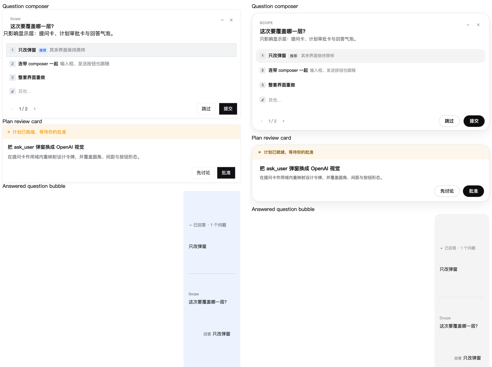

# dsh-ui-copy

DeepSeek Harness 的界面改写插件。它不改动任何官方包：浏览器半只改写三处已渲染的文本并覆写强调色令牌，宿主半只把一张 ask 弹窗样式表内联进页面。

| 目标 | 位置 | 行为 |
| --- | --- | --- |
| 空态大标题 | `hero.headline`（原为「探索未至之境」） | 从当前语言池中随机取一句；React 每次把原句写回时重新取，自己写的那句不会被反复打乱 |
| 输入框空置提示 | hero 态与普通态各一组 | 每组随机取一句俏皮话，按 React 传入的原句识别状态，同时同步 `aria-label` |
| 预览版徽章 | 标题右侧的 `预览版` | 整条隐藏 |
| UI 强调色 | `--dsw-alias-brand-primary` 与 `--dsw-alias-link` / `--dsw-alias-state-business-primary` 两组令牌 | 按主题换成配置里的颜色 |
| ask 提问弹窗 | `ask_user_question` 的提问卡、计划审批卡、回答气泡 | 换成 OpenAI / ChatGPT 的视觉语言 |

默认文案写在 `lib/client.js` 的 `DEFAULTS` 里：标题与输入框都是「一组句子随机取一句」，改成单元素数组即固定不轮换；`hidePreviewBadge` 默认 `true`；`accent` 为空表示不动强调色。输入框的句子不含 `/`、`@` 之类的提示。

## 组件

这个包在插件页里摊成两行，各自可以单独停用：

| 组件 id | 入口 | 职责 |
| --- | --- | --- |
| `ui-copy` | `dsh-ui-copy`（浏览器半只） | 文案改写：大标题轮换、输入框提示、预览版徽章；强调色覆写 |
| `ui-copy-ask` | `dsh-ui-copy/ask`（宿主半只） | ask 弹窗的 OpenAI 视觉 |

两条行由 `cordis.patch.yml` 声明，同包不同入口 —— 官方 `@deepseek-ai/dsh-headless/startup`、`@deepseek-ai/dsh-tool-cordis/host` 用的是同一种做法。只想要其中一半时，在插件页关掉对应开关，或在 profile 的 `cordis.patch.yml` 里给同 id 追加 `disabled: true`。

插件的标题与描述取自包根的 `locale/zh.json`、`locale/en.json`（`meta.title` / `meta.description`）；两条组件行共用同一份，因为元数据是按包解析的。

## ask 弹窗的 OpenAI 视觉

`lib/ask-surface.css` 把 `@deepseek-ai/dsh-client-ui-user-questions` 渲染的三块界面换成 OpenAI / ChatGPT 的设计语言。



> 左为官方默认，右为启用之后。深色对比见 `docs/compare-dark.png`。

- **卡片** — 24px 圆角、1px 中性描边、两层柔和投影，纯白 / `#262626` 表面
- **色板** — 全中性、去掉蓝移，正文 `#0d0d0d` / `#ececec`，次级与三级灰按 ChatGPT 的层级取值
- **标题区** — eyebrow 转大写小字距标签，标题 17px/600 并收紧字距
- **选项行** — 14px 圆角、44px 行高、悬停浅灰洗色，选中态改用 1px 描边而不是填充块
- **自由回答框** — 内凹表面，聚焦时边框提亮
- **底部操作** — 按钮胶囊化，主按钮黑底白字，深色下白底黑字
- **计划审批卡与回答气泡** — 与提问卡同一套令牌和形态

颜色与圆角是在作用域内**重映射设计令牌**（`--dsw-alias-*`、`--dsw-specific-*`、`--dsw-radius-*`）实现的，而不是逐个覆盖组件类名，因此经由像素库渲染的按钮、Markdown 会自动跟随，也不需要知道任何一个原始类名。三块界面分别锚在 `[data-question-key]`、`[data-plan-review-key]`、`[data-question-reply]` 上，弹窗之外没有任何影响。

样式表由宿主半只从磁盘读取并内联进 `<head>`：改 `lib/ask-surface.css` 后刷新页面即生效，不需要重启或重装；调试时可以直连 `/dsh-ui-copy/ask-surface.css` 看当前内容。

样式表里的类名取自 `dsh-client-ui-user-questions` 0.2.0-rc.2 的 CSS 模块 token（`y21zpG_*` 提问卡、`R7PCuq_*` 计划审批、`Dh9Boq_*` 回答气泡）。DSH 升级后这些前缀可能变化，此时装饰会失效而布局不会塌，因为每条依赖前缀的规则都配了结构选择器（`section` / `header` / `footer` / `textarea` / `role`）。重新对齐只需替换这三个前缀。

## 改文案

两种改法，任选其一。

**一、直接改源码**（保存后刷新页面即可，此插件无构建步骤）

```js
// lib/client.js
const DEFAULTS = {
  headline: {
    zh: ['有什么可以帮你的？', '……'],
    en: ['What can I help you with?', '……'],
  },
  // 键是 React 传来的原句（一个状态一条，换语言再加），值是这一状态要显示的句子池
  placeholders: {
    '描述你想要构建的内容, / 调用指令, @ 文件或对话': ['说点什么，剩下的我来', '……'],
    '发消息或创建任务, / 调用指令, @ 文件或对话': ['接着聊，我听着', '……'],
  },
  hidePreviewBadge: true,
  css: '',
}
```

想加任意其他改写，用 `css` 字段塞样式，或照 `applyPlaceholders` 的样子加一条规则。

**二、走 profile 配置**（不动插件源码）

在 `~/.dsh/profiles/desktop/cordis.patch.yml` 里追加：

```yaml
- id: ui-copy
  name: dsh-ui-copy
  config:
    hidePreviewBadge: true
    headline:
      zh: ['有什么可以帮你的？']
    placeholders:
      '描述你想要构建的内容, / 调用指令, @ 文件或对话': ['说点什么，剩下的我来']
```

未写的字段沿用 `DEFAULTS`；`placeholders` 是按原句键合并的，所以只写想改的那几条即可。

## 改强调色

`accent` 把两族强调令牌统一成一个颜色：中性品牌色 `--dsw-alias-brand-primary`（主按钮填充、开关选中、选区描边、dock 提示）与蓝色业务色 `--dsw-alias-link`、`--dsw-alias-state-business-primary`（链接、焦点环、业务态徽标），再加设置页与活动标签条用的那个上游畸形别名 `--dsw-alias-brand-primary-new-colorprimary-new-color`。

在 profile 的 `cordis.patch.yml` 里给 `ui-copy` 那一行加配置：

```yaml
- id: ui-copy
  name: dsh-ui-copy
  config:
    accent:
      light: '#7c4dff'
      dark: '#b79cff'
```

- `light` 与 `dark` 各一个颜色，某一项写空字符串表示该主题保持官方色；写成一个字符串（`accent: '#7c4dff'`）则两个主题同色。默认两个都是空字符串，即不介入。
- 派生值：主按钮悬停色按主题朝黑（浅色）或白（暗色）混合 16%；强调色上的文字在 `#rgb` / `#rrggbb` 输入下按 WCAG 对比度自动取黑或白，其它写法（`oklch()`、颜色名、`var()`）保留主题原本的文字色。
- 令牌声明落在 `html body` 与 `html body *`，靠特异性压过官方主题的 `body` / `body *`，并且不使用 `!important`，因此在自身作用域内重映射令牌的组件（本插件的 ask 弹窗即是）仍然优先。
- ask 弹窗经 `--dsh-ui-copy-accent` 与 `--dsh-ui-copy-accent-ink` 跟随同一个强调色；未配置时回落到官方中性色，视觉与之前一致。
- 官方 `--dsw-static-deepseek-*` 调色板不改动。若仍有残留的蓝色，用 `css` 字段追加覆盖。
- 此项是纯 CSS 变量覆写，主题切换、页面刷新都实时跟手，不需要重启宿主。

## 安装

profile 的 `package.json` 按此登记：

```json
"dependencies": {
  "dsh-ui-copy": "github:Alamanes/applesdsh-dev#path:plugins/dsh-ui-copy"
},
"dsh": {
  "profile": {
    "bundles": ["...", "dsh-ui-copy"]
  }
}
```

再在该 profile 目录执行 `pnpm install` 装好 `node_modules`，重启 DSH（或经插件页启用该行）后生效。停用只需从 `bundles` 里删掉 `dsh-ui-copy`。

## 为什么不走 locale 与槽位

这两条路都试过，堵死：

- `ctx.locale.register(ns, dict)` 在同一「命名空间 + 语言」已有词典时直接抛错，而 `conversation` 命名空间的 `zh`/`en` 由官方包先注册，插件覆盖不到 `hero.headline`。
- Hero 区只开了 `conversation.hero.brand.mark` 一个槽（鱼形标志），标题文字没有座位；`conversation.composer` 虽为 chain 槽，但空会话时以 `fallbackOnly` 渲染，链上注册够不到 Hero。

因此改用 DOM 改写，配 rAF 节流的 MutationObserver 在 React 重渲染后补回。代价是锚点依赖当前版本的结构：`titleGroup`、`previewBadge`、`data-placeholder`、`data-composer-placeholder`。官方若改结构与类名，改这里的四个选择器即可。
